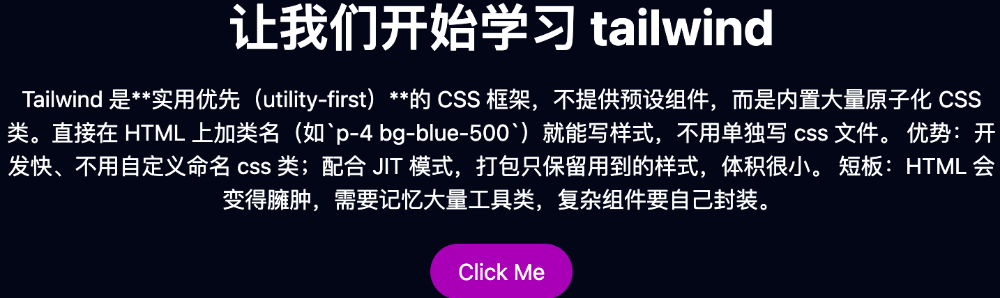
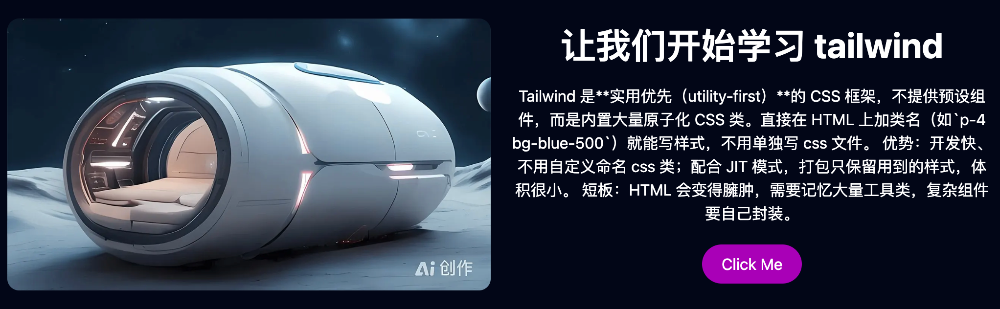
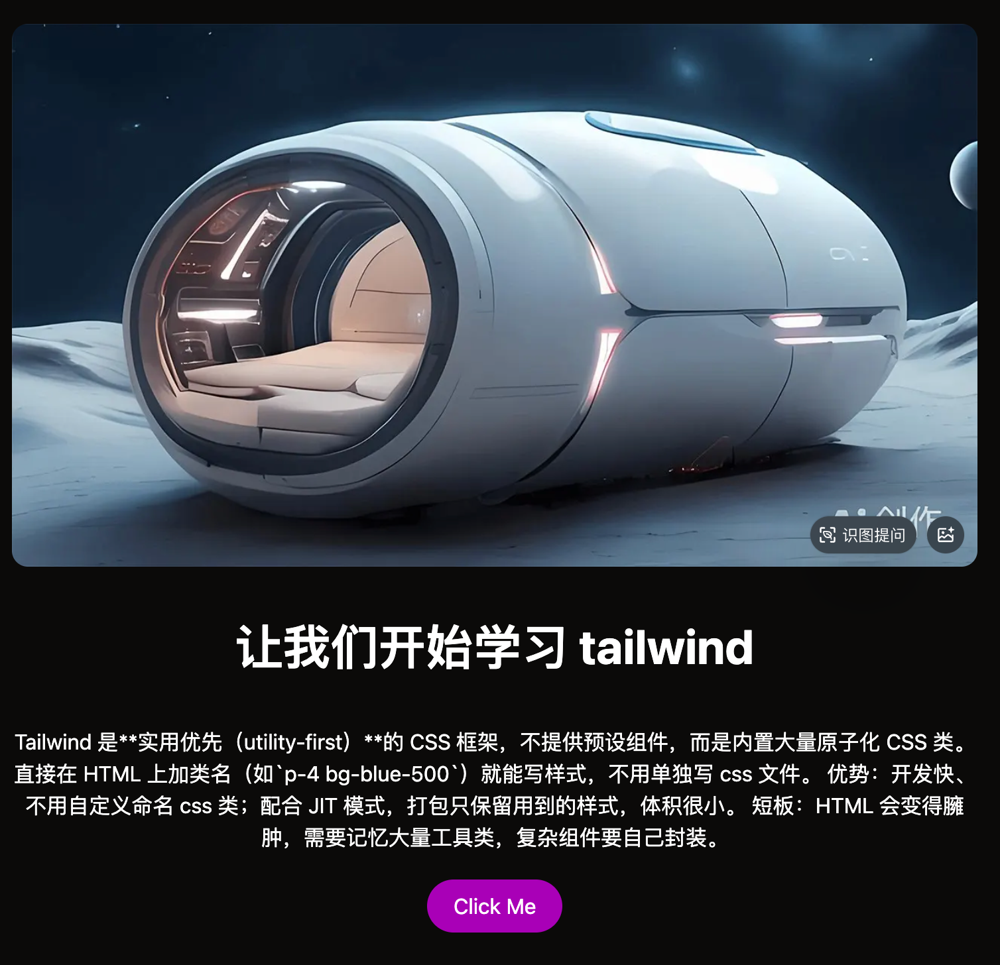
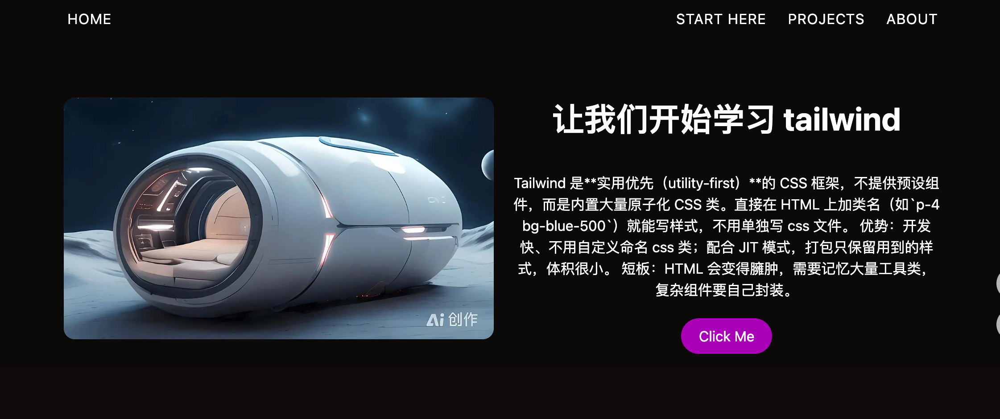
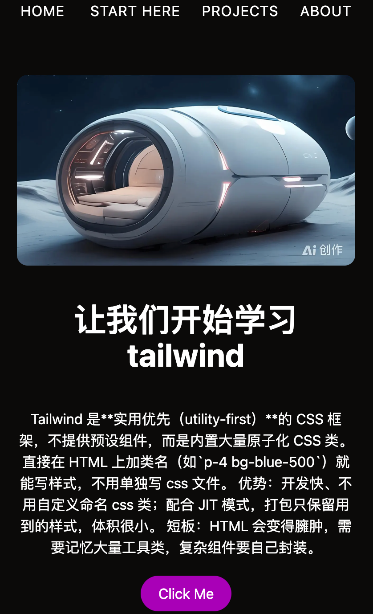

# tailwindcss

# 1. 简介

Tailwind CSS 是一个“工具优先”的 CSS 框架。它的核心理念是：不写自定义的 CSS 样式，而是在 HTML 中使用现成的、细粒度的工具类来拼装样式。

具有如下特点：
- 工具优先：优先使用 tailwindcss 提供的细粒度工具类，如 `bg-red-500`、`text-center` 等等。
- Web 优先：内置了响应式设计（`sm:`、`lg:` 前缀）、暗黑模式（`dark:` 前缀）、CSS 变量、容器查询等现代 CSS 特性。
- 按需生成，体积小：tailwindcss 会扫描你的项目文件，只生成你实际使用到的那部分 CSS 样式，所以生产环境下的 CSS 文件体积通常比较小。
- 高度定制化：自定义颜色、间距、字体等设计令牌（Design Token），形成一套统一的设计系统。

# 2. 安装方式

## 2.1 使用 Vite

```shell
# 1. 安装依赖包
npm install tailwindcss @tailwindcss/vite
```

```ts
// 2. 配置 vite的插件  tailwindcss()
// vite.config.ts
import { defineConfig } from 'vite'
import tailwindcss from '@tailwindcss/vite'

export default defineConfig({
  plugins: [
    tailwindcss(),
  ],
})
```

```css
/* 3. 在入口css文件(如 style.css )中引入 tailwindcss */
@import "tailwindcss";
```

## 2.2 使用 PostCSS

```shell
# 1. 安装依赖
npm install tailwindcss @tailwindcss/postcss postcss
```


```ts
// 2. 配置 postcss 插件 @tailwindcss/postcss
// postcss.config.js
export default {
  plugins: {
    "@tailwindcss/postcss": {},
  }
}
```

```css
/* 3. 在入口css文件(如 style.css )中引入 tailwindcss */
@import "tailwindcss";
```

## 2.3 Tailwind CLI


```shell
# 1. 安装依赖包
npm install tailwindcss @tailwindcss/cli
```
```css
/* 2. 在入口css文件(如 style.css )中引入 tailwindcss */
@import "tailwindcss";
```

```shell
# 3. 执行 CLI 命令编译 css 文件
npx @tailwindcss/cli -i ./src/style.css -o ./src/output.css --watch
```
## 2.4 框架中使用

大家使用的框架，构建工具不一定是 vite。这时可以通过 *2.2* 中的 postcss 方式，在对应的构建工具中引入 postcss 即可。

# 3. 基础使用

先准备一段基本的 `HTML` 代码片段。这段 `HTML` 代码有 `<h1>`、`<p>`、`<a>` 标签。在不引入 tailwindcss 的情况下，它们有浏览器赋予的默认样式。比如 `<h1>` 标签，默认字体大小是 `2rem`、字体加粗、前后有 `0.67rem` 的边距（margin）。

但是引入 tailwindcss 之后，这些浏览器的默认样式已经被清理掉。我们在这个基础上，结合 `tailwindcss` 把它改造成想要的样子。


```html
<div>
    <h1>让我们开始学习 tailwind</h1>
    <p>
          Tailwind 是**实用优先（utility-first）**的 CSS 框架，不提供预设组件，而是内置大量原子化 CSS 类。直接在 HTML 上加类名（如`p-4 bg-blue-500`）就能写样式，不用单独写 css 文件。
          优势：开发快、不用自定义命名 css 类；配合 JIT 模式，打包只保留用到的样式，体积很小。
          短板：HTML 会变得臃肿，需要记忆大量工具类，复杂组件要自己封装。
    </p>
    <a class=""> Click Me</a>
</div>
```

## 3.1 字体和文本


```html
<h1 class="font-sans font-bold text-4xl text-center">让我们开始学习 tailwind</h1>
```

- font-sans: 给 `<h1>` 标签增加无衬线字体。
- font-bold: 字体加粗，相当于 `font-weight:700;`
- text-4xl: 字体大小，相当于 `font-size:2.25rem;`
- text-center: 水平居中对齐，相当于 `text-align: center;`

## 3.2  边距

边距包括 外边距 `margin` 和 内边距 `padding`。 

```html
<div class="space-y-5"> <!-- <- 1. 新增样式 -->
    <h1 class="font-sans font-bold text-4xl text-center">让我们开始学习 tailwind</h1>
    <p>
          Tailwind 是**实用优先（utility-first）**的 CSS 框架，不提供预设组件，而是内置大量原子化 CSS 类。直接在 HTML 上加类名（如`p-4 bg-blue-500`）就能写样式，不用单独写 css 文件。
          优势：开发快、不用自定义命名 css 类；配合 JIT 模式，打包只保留用到的样式，体积很小。
          短板：HTML 会变得臃肿，需要记忆大量工具类，复杂组件要自己封装。
    </p>
    <a class="inline-block py-2 px-5"> Click Me</a> <!-- <- 2. 新增样式 -->
</div>
```
- space-y-5: 在垂直方向上，给直接子元素（最后一个除外）增加外边距 `margin` `1.25rem`，对应 `20px`。
- py-2: 给 `<a>` 标签增加垂直方向 `0.5rem` 的内边距 `padding`，相当于 `padding-top: 0.5rem;padding-bottom:0.5rem;` 
- px-5: 给 `<a>` 标签增加水平方向 `1.25rem` 的内边距 `padding`，相当于 `padding-left: 1.25rem;padding-right:1.25rem;` 
- inline-block: `<a>` 标签默认是 `inline` 内联样式，相当于 `display:inline-block;`

## 3.3 背景色+圆角

```html
<div class="space-y-5 bg-slate-950 text-white text-center"> <!-- <- 1. 新增样式 -->
  <h1 class="font-sans font-bold text-4xl text-center">让我们开始学习 tailwind</h1>
  <p>
          Tailwind 是**实用优先（utility-first）**的 CSS 框架，不提供预设组件，而是内置大量原子化 CSS 类。直接在 HTML 上加类名（如`p-4 bg-blue-500`）就能写样式，不用单独写 css 文件。
          优势：开发快、不用自定义命名 css 类；配合 JIT 模式，打包只保留用到的样式，体积很小。
          短板：HTML 会变得臃肿，需要记忆大量工具类，复杂组件要自己封装。
  </p>
  <a class="inline-block py-2 px-5 bg-fuchsia-700 hover:bg-fuchsia-600 hover:cursor-pointer transition-colors rounded-full"> Click Me</a> <!-- <- 2. 新增样式 -->
</div>
```

在 `# 3.2` 的基础上，给 `div`标签 增加了如下样式:
- bg-slate-950: 背景色设置为 黑色 背景。
- text-white: 设置白色字体，因为`CSS`的继承性，`<h1>`、`<p>`、`<a>` 的颜色会变成白色。
- text-center: 字体水平居中对齐，相当于 `text-align: center;`

给 `<a>` 标签增加了如下样式：
- bg-fuchsia-700: 增加紫红色背景色
- hover:bg-fuchsia-600 : hover 时，紫红色背景变淡，由 `700` 变为 `600`
- hover:cursor-pointer : hover 时，鼠标变成小手形状，相当于 `cursor: pointer;`。
- transition-colors: 颜色过渡动画，让 hover 时的背景色变化更平滑。
- rounded-full: 给按钮增加圆角，`full` 表示最大的圆角。

到此，目前的页面样式：



# 4. grid布局 和 媒体查询

在 `3. 基础使用` 的基础上，我们增加一张图片让页面更加丰富。

图片我们使用 `rounded-xl` 增加一个 `0.75rem` 的圆角。 

```html
<section> <!-- 1. 增加 section 标签 -->
   <!-- 2. 增加 img 标签 -->
  <div class="space-y-5 bg-slate-950 text-white text-center"> <!-- 这个标签内都是 3. 基础使用的标签和样式 -->
    <h1 class="font-sans font-bold text-4xl text-center">让我们开始学习 tailwind</h1>
    <p>
            Tailwind 是**实用优先（utility-first）**的 CSS 框架，不提供预设组件，而是内置大量原子化 CSS 类。直接在 HTML 上加类名（如`p-4 bg-blue-500`）就能写样式，不用单独写 css 文件。
            优势：开发快、不用自定义命名 css 类；配合 JIT 模式，打包只保留用到的样式，体积很小。
            短板：HTML 会变得臃肿，需要记忆大量工具类，复杂组件要自己封装。
    </p>
    <a class="inline-block py-2 px-5 bg-fuchsia-700 hover:bg-fuchsia-600 hover:cursor-pointer transition-colors rounded-full"> Click Me</a>
  </div>
</section>
```

## 4.1 grid布局

我们使用 `grid` 布局让图片和文案左右排列。

```html
<section class="grid gap-5 grid-cols-2 items-center bg-slate-950 max-w-5xl mx-auto px-2 py-5">
  <!-- ... -->
</section>
```
- grid: `grid`布局，相当于 `display:grid;`
- gap-5: 网格之间间隔 `1.25rem` (`20px`)，相当于 `gap: 1.25rem;`
- grid-cols-2: 将一行分成两列，相当于 `grid-template-columns: repeat(2, minmax(0, 1fr));`
- items-center: 垂直居中对齐，相当于 `align-items: center;`
- bg-slate-950: 接近黑色背景，让图片和文本的背景都是黑色。

此外我们额外增加了 `max-w-5xl` 和 `mx-auto`
- max-w-5xl: 将 `<section>` 框设定一个最大宽度 `64rem`,避免在超大屏幕场景中，图片和文本这两列内容过宽。
- mx-auto: 配合 `max-w-5xl` 一起使用，当屏幕宽度比 `max-w-5xl` 还大时，水平居中显示，相当于 `margin-inline: auto;`

而 `px-2` 和 `py-5` 主要是增加一点内边距，让排版更好看。



## 4.2 媒体查询

`max-w-5xl` 的宽度是 `64rem`（即 `1024px`）。对于小屏幕来说，这个最大宽度限制意义不大。
如果希望：
- 大屏幕最大宽度为 `max-w-5xl`，小屏幕宽度设置为 `max-w-3xl`。
- 同时小屏幕图片和文本不再是一行两列，而是一行一列。

```html
<section class="grid gap-5 lg:grid-cols-2 items-center bg-slate-950 max-w-3xl lg:max-w-5xl mx-auto px-2 py-5">
  <!-- ... -->
</section>
```

我们主要调整：
- max-w-3xl: 新增class，默认最大宽度为 `max-w-3xl`, `48rem`（即 `768px`）。
- lg:max-w-5xl: `lg:` 表示大于 `64rem`（即 `1024px`）的时候，最大宽度为 `max-w-5xl`。
- lg:grid-cols-2: 原来 `grid-cols-2` 增加了前缀 `lg:`，即在大于 `64rem`（即 `1024px`）时，才是一行两列的布局。

`lg:` 等媒体查询前缀可以参考
| Breakpoint prefix | Minimum width | CSS |
| ---- | ---- | ---- |
| sm | 40rem (640px) | `@media (width >= 40rem) { ... }` |
| md | 48rem (768px) | `@media (width >= 48rem) { ... }` |
| lg | 64rem (1024px) | `@media (width >= 64rem) { ... }` |
| xl | 80rem (1280px) | `@media (width >= 80rem) { ... }` |
| 2xl | 96rem (1536px) | `@media (width >= 96rem) { ... }` |


小屏幕效果：



# 5. flex布局

为了了解 `tailwind` 中的 `flex` 布局，我们使用网站导航栏来说明。

```html
<header class="max-w-3xl lg:max-w-5xl mx-auto px-5 py-3">
  <nav>
    <ul class="uppercase flex justify-center sm:justify-between gap-x-4 gap-y-1 flex-wrap">
      <li class="me-auto"><a href="">Home</a></li>
      <li><a href="">Start Here</a></li>
      <li><a href="">Projects</a></li>
      <li><a href="">About</a></li>
    </ul>
  </nav>
</header>
```

为了实现导航栏目，我们使用了语义化的 `HTML` 标签，`<header>`和`<nav>`。

`<header>`标签中的 `class`，我们之前都使用过了，这里我们不再重复。

重点看 `<ul>` 标签和第一个 `<li>` 标签上的 `class`。

```html
<ul class="uppercase flex justify-center sm:justify-between gap-x-4 gap-y-1 flex-wrap">
  <li class="me-auto"><a href="">Home</a></li>
  <!-- ... -->
</ul>
```

`<ul>` 标签的 `class` 拆解：

- uppercase: 将所有文本转为大写字母，相当于 `text-transform: uppercase;`
- flex: 弹性布局，相当于 `display: flex;`。`<ul>` 默认是块级元素，改成 `flex` 后，所有 `<li>` 子元素从纵向排列变成横向排列。
- justify-center: 主轴（水平方向）居中对齐，相当于 `justify-content: center;`。所有导航项挤在中间。
- sm:justify-between: `sm:` 是响应式前缀，表示屏幕宽度 `>= 40rem`（`640px`）时生效。`justify-between` 让首尾两个 `<li>` 分别贴紧左右两端，中间的均匀分布。所以小屏幕居中、大屏幕两端对齐。
- gap-x-4: 子元素之间的水平间距 `1rem`（`16px`），相当于 `column-gap: 1rem;`
- gap-y-1: 子元素之间的垂直间距 `0.25rem`（`4px`）。配合下面的 `flex-wrap`，当导航项换行时控制行间距。
- flex-wrap: 允许换行，相当于 `flex-wrap: wrap;`。屏幕太窄时导航项不会溢出，而是自动折到下一行。

第一个 `<li>` 标签上的 `me-auto` 是关键：

- me-auto: `me` 是 **margin-inline-end** 的缩写（逻辑属性，`end` 在从左到右的语言里等于 `right`）。`auto` 表示自动撑满剩余空间。相当于 `margin-inline-end: auto;`

效果是这样的：`Home` 这个 `<li>` 被推到最左边，它的 `margin-right` 吸收了所有剩余空间，把后面的导航项全部挤到最右边。这和 `justify-between` 的效果不同——`justify-between` 是所有项目均匀分布，而 `me-auto` 是把导航栏分成左右两组：`Home` 在左，其余在右。

```
小屏幕 (居中):          Home  Start Here  Projects  About
                        ↑──────全部居中──────↑

大屏幕 (两端对齐):      Home    Start Here  Projects  About
                        ↑──────均匀分布──────────↑

带 me-auto:             Home                      Start Here  Projects  About
                        ↑__margin-right:auto__↑
```

将本文的内容结合在一起的效果：
- 大屏幕



- 小屏幕

